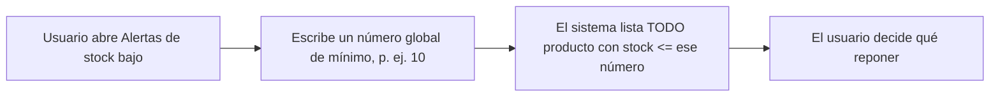
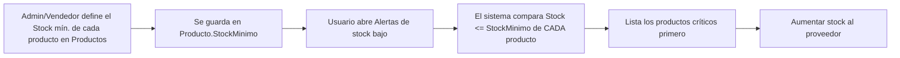

# Proceso "Alerta de stock bajo" · AS-IS / TO-BE

**Mejora T3:** Stock mínimo por producto (rama `feature/stock-minimo-producto`).

## AS-IS (T2)

Problema: un mismo número no sirve para todos (un cargador necesita 30 de colchón; una laptop, 2).

## TO-BE (T3)

Además: en **Productos** hay un buscador (nombre, marca o proveedor) y las filas con stock bajo se pintan en rojo.
Las bases de datos antiguas se actualizan solas (`StockMinimo` = 5 por defecto, sin perder datos).
